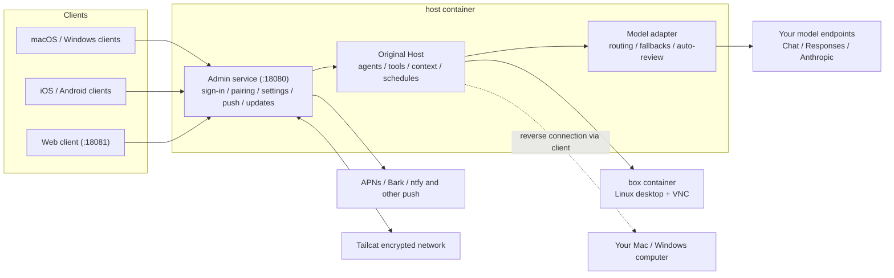

<p align="center">
  
</p>

<h1 align="center">RokBot</h1>

<p align="center">
  A private AI assistant that runs on your own server, with the models you choose, your data kept on your machine, and access from desktop, mobile and the browser.
</p>

<p align="center">
  <a href="LICENSE"></a>
  <a href="#supported-platforms"></a>
  <a href="#quick-start"></a>
</p>

<p align="center">
  <a href="docs/media/rokbot-promo.mp4">
    
  </a>
  <br />
  <sub><a href="docs/media/rokbot-promo.mp4">Watch the full promo video (80 seconds, with narration; in Chinese)</a></sub>
</p>

<!-- 用户可在 GitHub 网页编辑器中把 mp4 拖入此处，生成 user-attachments 链接后即可内嵌播放 -->

<p align="center">
  <a href="README.md">简体中文</a> ·
  <strong>English</strong> ·
  <a href="#features">Features</a> ·
  <a href="#quick-start">Quick Start</a> ·
  <a href="#getting-the-clients">Getting the clients</a> ·
  <a href="#documentation">Documentation</a> ·
  <a href="#faq">FAQ</a>
</p>

<div align="center">

<table>
  <tr>
    <td align="center"><br /><sub>Bot list</sub></td>
    <td align="center"><br /><sub>Chat and image generation</sub></td>
    <td align="center"><br /><sub>The Bot's computer and routines</sub></td>
    <td align="center"><br /><sub>Approval card</sub></td>
  </tr>
</table>

</div>

## Overview

RokBot is a self-hosted AI assistant for personal use. The agent server (the Host) and the Bot's desktop (`box`) run in Docker on your own machine, and model calls go to the OpenAI- or Anthropic-compatible endpoints you configure. The macOS, Windows, Android and iOS clients and the web client connect only to your Host.

Conversations, files, settings and API keys stay on the Host's data volumes. This repository contains only what this project wrote itself: the Host source, the image build scripts, the per-platform patch tools and build scripts, and the documentation. It does not contain or distribute any original program files or client installers. You can build the clients yourself with the patch tools, or get them from a Host you deploy yourself; see [Getting the clients](#getting-the-clients).

## Features

### The Bot's computer and live takeover

- The Host ships with a Linux desktop container (`box`). Bots use its browser, terminal and files to do their work. Home and workspace directories live on their own data volumes.
- Clients can open a live VNC view of the Bot's computer and take over with mouse, keyboard or touch.
- Bots can also work on your own computer through the Host: on a Mac they can run commands and control the GUI, and on Windows they can run local commands. The client connects out to the Host, so the computer does not need any open ports.
- You can replace the built-in `box` with a remote Linux execution node, configured on the Execution page of the admin console.

### Continuity across devices and notifications

- Conversations and settings live on the Host, and every client connects to the same Host. You can start a task on your computer and follow up on your phone or in the browser.
- The chat list can be sorted by last message and grouped: Needs attention, Unread and Read on desktop and web, with an additional In progress group on Android.
- Notification channels:
  - iOS can use APNs or Bark.
  - The Android client keeps its own connection to the Host and can also use ntfy, UnifiedPush, FCM or a webhook.
  - The web client uses browser notifications while the page is open.
- Notifications can be sent on every reply or only when a task completes.

### Bring your own models

- Three API formats are supported: OpenAI Chat Completions, OpenAI Responses and Anthropic Messages. Any service that speaks one of these formats can be connected.
- Model services and model profiles organize several providers and models.
- The default route and per-Bot routes each set the model, the reasoning effort and a fallback order, with up to 8 fallbacks per route.
- If the primary model fails with 402, 408, 429, 5xx or a network error before producing any output, the next fallback takes over. Once output has started there is no switch, so output and tool calls are never repeated.
- You can fetch model lists and test connections in the admin console or in the clients. Changing the model configuration from a client requires a device paired with the admin password.
- Optional JEV routing picks a model profile by task difficulty. It requires an API key for the JEV service and is off by default.

### Image and video generation

- The Images & video page of the admin console connects providers: OpenAI-compatible image and video APIs, WaveSpeed, or a custom HTTP JSON endpoint.
- Image generation, video generation, video understanding and video review each have their own default model. Results come back to the conversation as attachments.
- You need to supply an API key for each provider.

### Voice

- Speech recognition uses Fish Audio or an OpenAI-compatible transcription service; a Mac can also use a local model.
- Voice calls use the current Bot's model, context and tools, with recognition and speech synthesis handled by the services you configure.
- Real-time calls are experimental.

### Scheduled tasks

- A local scheduler in the Host runs Bot routines on cron schedules, with no external scheduling service.
- Each routine has at most one run in progress, and missed slots are merged into a single catch-up run.

### Webhooks

- The Webhook page of the admin console creates a trigger for a chosen Bot. You set a task template, an optional event-type filter and a per-minute limit.
- Requests are verified with HMAC-SHA256 signatures and a ±5-minute window. The request URL and signing secret are shown once at creation and can be reset later.
- Every delivery is recorded in a run log.

### Auto-review and approval cards

- Before a Bot performs a risky action, the model you configured decides whether to allow it, using the original classification rules. This covers shell commands, MCP calls, computer use, writes to scheduled tasks and sub-agent launches. You can write your own allow and block rules.
- A blocked action appears as a native approval card where you deny or allow it.
- Cards expire after 30 minutes by default; `ROKBOT_AUTO_REVIEW_APPROVAL_TTL_MS` sets the timeout.
- Auto-review is turned on in the client settings.

### Usage statistics

- Input, output, cache read/write and reasoning tokens are recorded per model.
- The admin Overview page and the client settings chart usage for today (hourly) and for the last 7 or 30 days (daily). They also show each model's share, a detail table and the cache hit rate.

### Self-hosted deployment and networking

- **Images:** prebuilt images are published on GitHub Container Registry (GHCR) and, like this repository, require access. One script configures, pulls and starts everything. Offline installs and building the images from source are also supported.
- **Architectures:** the Host image supports `linux/amd64` and `linux/arm64`. The `box` desktop image is `linux/amd64` only, so ARM hosts need binfmt/QEMU or Rosetta.
- **Ports:** the admin console (`18080`) and the web client (`18081`) listen on `127.0.0.1` by default. `ROKBOT_LISTEN_ADDRESS` changes the listen address.
- **Sign-in:** no cloud account is needed. Devices sign in with a single-use 6-digit pairing code that is valid for 5 minutes, or with the admin password.
- **LAN:** clients can connect directly by IP address, and the Android client can scan the local network for Hosts.
- **Remote access:** the built-in Tailcat encrypted network needs no Tailscale account. Tailscale and HTTPS reverse proxies also work.
- **Client updates:**
  - You publish installers for each platform on the Client updates page.
  - Android and desktop clients receive delta patches, and desktop update manifests are signed with ECDSA P-256.
  - iOS installs through `itms-services` (HTTPS required) or an AltStore / SideStore source.
- **Privacy:**
  - API keys are write-only. The admin API only reports whether a key is set, and keys are stored in `/data/model.env` on the Host data volume.
  - Telemetry and crash reporting are disabled in the Host and in every client.

## Screenshots

These screenshots were taken from a RokBot Host and native clients loaded with demo data. They contain no real accounts.

### Android client

The chat list, a conversation, Bot details and the approval card are shown at the top of this page; the rest are below.

<table>
  <tr>
    <td align="center"><br /><sub>Question card</sub></td>
    <td align="center"><br /><sub>Usage</sub></td>
    <td align="center"><br /><sub>Model settings</sub></td>
    <td align="center"><br /><sub>Settings</sub></td>
  </tr>
  <tr>
    <td align="center"><br /><sub>Connect to a Host</sub></td>
    <td align="center"><br /><sub>Connection and diagnostics</sub></td>
    <td align="center"><br /><sub>System share sheet</sub></td>
    <td align="center"><br /><sub>About and updates</sub></td>
  </tr>
</table>

### Desktop

The desktop clients (macOS and Windows) share their interface with the web client. Both screenshots below use the desktop layout.

| Chat list and conversation | The Bot's computer: live desktop view |
| --- | --- |
|  |  |

### Admin console

| Overview and usage | Chat models and routing |
| --- | --- |
|  |  |
| **Images and video** | **Voice** |
|  |  |

The Android screenshots use the English interface; the desktop and admin screenshots use the Chinese interface. Android, desktop, web and the admin console all offer both languages.

## Supported Platforms

This repository does not provide client installers. Each client is obtained as shown in the "How to get it" column, and the patches accept only the official versions below. The versions come from the configuration files pinned in the repository.

| Platform | Form | Official version required | How to get it | Guide |
| --- | --- | --- | --- | --- |
| macOS | Apple Silicon client | 1.2.3 | Build it yourself / From your Host | [`mac/README.en.md`](mac/README.en.md) |
| Windows | x64 installer and portable build | 1.2.3 (recommended); 0.71.2 also accepted | Build it yourself / From your Host | [`windows/README.en.md`](windows/README.en.md) |
| Web | Browser; can be added to the home screen | Interface from Windows 1.2.3 (recommended) or 0.71.2 | Build the bundle yourself and upload it to your Host | [`web/README.en.md`](web/README.en.md) |
| Android | Native APK (arm64-v8a) | 1.26.0 (build 3212) | Build it yourself / From your Host | [`android/README.en.md`](android/README.en.md) |
| iOS | IPA; bring your own decrypted official IPA | 1.27.0 (29519); 1.26.0 and 1.16.0 also accepted | Build and sign it yourself / From your Host | [`ios/README.en.md`](ios/README.en.md) |
| Linux server | Docker: `host` (amd64 / arm64) and `box` (amd64) | Host baseline `97658ad` (`2bb5e41` kept as fallback) | Build the images from source / Pull the prebuilt images (access required) | [`host/README.en.md`](host/README.en.md) |

See [Getting the clients](#getting-the-clients) for both methods.

The pinned versions come from these files: `mac/patchers/desktop/supported.json`, `windows/patchers/desktop/supported.json`, `web/patchers/supported.json`, `android/recipes/manifest.json`, `ios/recipes/ios/manifest.json` and `host/recipes/host/manifest.json`.

## Quick Start

### 1. Deploy the Host and the execution container

You need a Linux or macOS server with Docker (including Compose v2). This repository is private, so anonymous requests to `raw.githubusercontent.com` fail. Clone the repository first (access required), then run the install script locally:

```bash
# Clone the repository; if you are signed in to the GitHub CLI you can use gh
gh repo clone hongfaqiu/rokbot rokbot-src
# Without gh, use git: git clone https://github.com/hongfaqiu/rokbot.git rokbot-src

mkdir rokbot && cd rokbot
bash ../rokbot-src/host/release/install-images.sh --local
```

`--local` makes the script copy `docker-compose.images.yml` and `.env.images.example` from the repository instead of downloading them. The prebuilt images also require access, so sign in to GHCR before pulling, with a token that has the `read:packages` scope:

```bash
echo "$GHCR_TOKEN" | docker login ghcr.io -u <GitHub username> --password-stdin
```

If you cannot pull the images, build them from source on the server instead; see [`docs/AI-INSTALL.en.md`](docs/AI-INSTALL.en.md).

The script does the following, in order:

1. Creates `.env` (mode 0600) with random secrets.
2. Pulls the images.
3. Starts the Host and `box` containers.
4. Waits for the health checks to pass, if your Compose version supports it.
5. Prints the admin console and web client addresses.

> [!TIP]
> - **Let an AI agent deploy it:** give [`docs/AGENT_DEPLOY.en.md`](docs/AGENT_DEPLOY.en.md) to an AI coding assistant such as Claude Code, Cursor or Codex. It will run the environment checks, the deployment and the acceptance steps from the runbook.
> - **Common options:**
>   - The command above already passes `--local`. Without it, the script downloads the templates from `raw.githubusercontent.com`, which fails anonymously for a private repository.
>   - To edit the configuration before starting, use `--prepare-only`, then run the command again without it (keep `--local`).
>   - For an offline install, import the images with `docker load` first and then use `--offline`.
> - **Mirrors and proxies:** set `ROKBOT_HOST_IMAGE` / `ROKBOT_BOX_IMAGE` in `.env` to use a mirror, or set `HTTP_PROXY` / `HTTPS_PROXY`.

### 2. Initialize the Host and connect a client

1. Get the one-time setup key:
   ```bash
   docker compose --env-file .env -f docker-compose.images.yml exec -T host cat /data/setup-key
   ```
2. Open the admin console at `http://127.0.0.1:18080/admin`, enter the setup key and set an admin password (12–128 characters).
3. Connect a client:
   - **Native clients:** first get a client as described in [Getting the clients](#getting-the-clients). Create a 6-digit pairing code under Devices & notifications in the admin console. Then enter the Host address and the code in the macOS, Windows, Android or iOS client. You can also sign in with the admin password.
   - **Web client:** enabled by default at `http://127.0.0.1:18081/web/`. The prebuilt images do not include the web client bundle. Before first use, build the bundle as described in [`web/README.en.md`](web/README.en.md) and upload it on the Web client page of the admin console.

### 3. Configure models

Open the Chat model page of the admin console (`/admin?view=model`), or the settings of a client paired with the admin password:

1. Add a model service: choose the API format (OpenAI Chat, OpenAI Responses or Anthropic), then enter the base URL and API key.
2. Fetch the model list, create a model profile and test the connection.
3. Set the default route. If needed, give individual Bots their own routes and fallbacks.

Once saved, you can create Bots and start chatting.

## Getting the clients

This repository does not provide ready-made client installers. There are two ways to get a client: build it yourself, or get it from a Host you deploy yourself.

### Option 1: Build it yourself

Bring your own official client installer, then patch and sign it with the patch tools in this repository. The tools first check the input's size and SHA-256 against the pinned configuration and stop if it is not one of the official versions in the table. Run every command below from the repository root, replacing the paths with your own files.

If you omit `--source` for the desktop clients or the web client, the tool fetches the pinned version from the official download address and verifies it just as strictly. `ROKBOT_DESKTOP_DOWNLOAD_BASE` points it at a mirror you host. Android and iOS always need an installer you supply.

| Platform | Runs on | Input | Output |
| --- | --- | --- | --- |
| macOS | macOS, Node.js 22.12+ | Official 1.2.3 Apple Silicon `.dmg` or `Grok Bot.app` | `mac/output.noindex/RokBot.app` |
| Windows | Windows 10/11 x64, Node.js 22.12+ | Official 1.2.3 (or 0.71.2) x64 installer, `app-64.7z` or an installed original directory | `windows/output/` |
| Web | Windows, macOS or Linux, Node.js 22.12+ | The same official installer as Windows | `web/output/RokBotLocal-web-1.2.3.zip` |
| Android | Node.js 20+ | Official 1.26.0 (build 3212) `.xapk`, `.apks` or `.apk` | The APK given by `--output-apk` |
| iOS | Python 3.9+ | An official IPA you decrypted yourself: 1.27.0 (29519), 1.26.0 (29388) or 1.16.0 (23152) | The new directory given by `--output` |

#### macOS

```bash
node mac/patchers/desktop/patch.mjs --source "/path/to/Grok_Bot_1.2.3.dmg"
```

- Produces `mac/output.noindex/RokBot.app` and keeps a copy of the original in `mac/backup.noindex/RokBot.app`. The tool does not overwrite an existing output.
- The app is ad-hoc signed by default. To control the Mac's GUI, add `--identity auto` to sign with a Developer ID Application or Apple Development certificate from your keychain.
- `--verify-only` replays the patches in a temporary directory without producing a client. See [`mac/README.en.md`](mac/README.en.md).

#### Windows

```powershell
node windows/patchers/desktop/patch.mjs --source C:\path\to\Grok_Bot_1.2.3_Setup.exe
```

- Produces, in `windows/output/`, the portable directory `RokBot Local/`, `RokBotLocal-1.2.3-x64-portable.zip`, the per-user installer `RokBotLocal-1.2.3-x64-Setup.exe` and the patch record `RokBotLocal-1.2.3-x64.patch.json`. Add `--no-installer` to build only the portable version.
- If 1.2.3 does not work for you, use `--version 0.71.2 --output windows/output/0.71.2`; the version in the file names changes accordingly.
- The patch removes the original signature, which no longer matches once the program is modified, so the generated program and installer are unsigned. See [`windows/README.en.md`](windows/README.en.md).

#### Web client

```bash
node web/patchers/patch.mjs --source /path/to/Grok_Bot_1.2.3_Setup.exe
```

- Produces `web/output/RokBotLocal-web-1.2.3.zip`, which you upload on the Web client page of the admin console. Alternatively, add `--upload <Host address>` to install it on the Host right after the build; the admin password is read from `ROKBOT_ADMIN_PASSWORD`, `--password-file` or the terminal.
- If the 1.2.3 interface does not work for you, add `--version 0.71.2`. See [`web/README.en.md`](web/README.en.md).

#### Android

```bash
node android/release/patch-android.mjs \
  --input-apk /path/to/official-1.26.0.xapk \
  --output-apk android/output/rokbot-android-patched.apk
```

- Produces a single 16 KB-aligned APK with v2/v3 signatures and writes `patch-report.json` next to it. Add `--force` to overwrite an existing output.
- The signing key is kept in `~/.rokbot-local/android-signing.json` by default and is created on the first run; `--keystore` chooses another path. Later upgrades must use the same key, so back it up separately.
- To publish upgrades through a Host, raise the version on every build with `--rokbot-build <n>` (1–99). See [`android/README.en.md`](android/README.en.md).

#### iOS

```bash
python3 ios/release/patch-ios.py \
  --input /path/to/decrypted.ipa \
  --output ios/output/RokBot-Patched \
  --bundle-id dev.rokbot.local
```

- `--output` must be a new directory that does not exist yet. It receives the unsigned `RokBot-Local-resignable.ipa`, `RokBotLocal.dylib` and `patch-report.json`, plus `extension-signing.json` when the extensions are kept.
- Sign it with your own signing tool and certificate, then install it. A free Apple ID allows only 3 App IDs, which is not enough for the main app and its three extensions; add `--remove-extensions` to keep only the main app. See [`ios/README.en.md`](ios/README.en.md).

### Option 2: Get it from your own Host

The administrator of a Host can publish the installers they built to the devices on that Host:

1. The administrator builds and signs the installers as in Option 1.
2. On the Client updates page of the admin console, they choose a platform (Android, iOS, macOS or Windows), upload the installer and publish it. They can optionally pick an older release to generate a delta patch from.
3. Paired clients check for and download updates from that Host:
   - Android checks the download's size, SHA-256, package name and signing certificate, and the certificate must match the installed app.
   - macOS and Windows receive delta patches, and their update manifests are signed with ECDSA P-256. By default the clients check the Host they are paired with. To pin the manifest signing key shown on the Client updates page into the client, build it with `--update-url <Host HTTPS address>/local/updates` and `--update-public-key-file <key file>`.
   - iOS apps cannot replace themselves, so iOS installs through `itms-services` (HTTPS required), an AltStore / SideStore source, or by downloading the IPA and handing it to a signing tool.

For the first install the client is not yet paired with the Host. How the installer reaches users is decided by, and is the responsibility of, the administrator of each Host. Publishing and API details are in [`docs/AGENT_DEPLOY.en.md`](docs/AGENT_DEPLOY.en.md#5-publishing-signed-4-platform-releases--incremental-updates).

## Architecture



- **Host:** the original Node.js program. Only the parts tied to official services are replaced (authentication, agent identity, model calls and MCP configuration), and an admin service sits in front of it.
- **Execution computer:** the official Linux desktop image, running unchanged in Docker. Agents can also work on your own computer.
- **Clients:** the original interface is kept, and the patches make it connect only to your Host. Patches only copy and add bytes, and every segment checks the original file's hash first. Nothing is decompiled or rewritten.

See [`docs/ARCHITECTURE.en.md`](docs/ARCHITECTURE.en.md) for the full design.

## Documentation

| Document | Contents |
| --- | --- |
| [`docs/AGENT_DEPLOY.en.md`](docs/AGENT_DEPLOY.en.md) | Runbook for AI coding agents: preflight checks, prebuilt-image and source deployments, first boot, model setup, releases and troubleshooting |
| [`docs/AI-INSTALL.en.md`](docs/AI-INSTALL.en.md) | Deploying with `host/deploy.py`: choosing machines, split deployment, operations, and volume backup and recovery |
| [`docs/ARCHITECTURE.en.md`](docs/ARCHITECTURE.en.md) | How it works, the feature comparison, each component, the directory layout, tests and known limitations |
| [`docs/PATCHING_WORKFLOW.en.md`](docs/PATCHING_WORKFLOW.en.md) | Per-platform patch baselines and the maintenance workflow |
| [`docs/REBRAND_COMPAT.md`](docs/REBRAND_COMPAT.md) | Rename registry: environment variables, interface identifiers and migration from older setups |
| [`tests/e2e/README.md`](tests/e2e/README.md) | How to run the black-box end-to-end test suite |
| [`SECURITY.md`](SECURITY.md) | How to report vulnerabilities, and deployment security advice |

## FAQ

**How do I reach the Host without a public IP?**

Turn on the built-in Tailcat on the Remote access page; no Tailscale account is needed. Tailscale, a VPN or an HTTPS reverse proxy also work. The web client does not support Tailcat, so use a VPN or an HTTPS domain to reach it remotely. Do not expose the admin console directly to the internet; see [`SECURITY.md`](SECURITY.md).

**Why can't my phone reach the Host on the LAN?**

`ROKBOT_LISTEN_ADDRESS` defaults to `127.0.0.1`, which only allows connections from the server itself. For LAN use, set it to the server's LAN IP, or to `0.0.0.0` behind a firewall. Note that ports published by Docker bypass host firewalls such as ufw.

**Can I deploy on an ARM server?**

Yes. The Host image supports `linux/arm64`. The `box` desktop image is `linux/amd64` only, so enable binfmt/QEMU on the host, or Rosetta on Apple Silicon.

**Why are there no client installers in the repository?**

This repository distributes only the code and documentation this project wrote itself. It contains no original program files and offers no patched installers. You can bring your own official installer and build the client on your machine with the patch tools, or get it from the administrator of your own Host, who publishes it on the Client updates page. Both methods are described in [Getting the clients](#getting-the-clients), and the reasons in [Distribution & compliance](#distribution--compliance).

**Where are API keys stored, and can they be read back?**

API keys are stored in `/data/model.env` on the Host data volume. The admin API and the clients only see whether a key is set, never the key itself.

**How do I back up my data?**

Data lives in three volumes: `host-data` (mounted at `/data`), `box-home` and `box-workspace`. With a `host/deploy.py` deployment, run `python3 host/deploy.py backup`. For recovery, see [`docs/AI-INSTALL.en.md`](docs/AI-INSTALL.en.md#volume-recovery). Backups contain conversations and keys, so keep them safe. Do not run `docker compose down -v`, which deletes the volumes.

## Distribution & compliance

- This project does not distribute binaries of third-party clients. The repository contains only what this project wrote itself: the Host source, image build scripts, patch tools, build scripts and documentation. Users obtain the original installers themselves.
- The patch tools are provided for personal study and self-hosting only. The noncommercial redistribution permitted by the [LICENSE](LICENSE) covers only this project's own code, not any part of the original programs.
- When you use the original clients and the patches, comply with the original client's license terms and the applicable terms of service.
- Do not distribute publicly the clients, web client bundles or images with a built-in bundle that you generate with the patch tools; use them only with your own Host. When installers are distributed through a Host, the administrator of that Host is responsible for the channel and for who receives them.
- This section is not legal advice. Whether a particular use is permitted depends on the original client's license terms and the laws where you live.

## License

RokBot is licensed under the [ProkBot Noncommercial License 1.0](LICENSE). It permits personal use, self-hosting, study, modification and noncommercial redistribution. All commercial use is prohibited, including:

- selling or licensing it for payment;
- paid hosting or paid services;
- incorporating it into commercial products;
- a business's internal operations;
- monetizing it through advertising or similar means.

The [LICENSE](LICENSE) file is authoritative. See [NOTICE](NOTICE) for derivation and third-party components.

RokBot builds on [ProkBot](https://gitee.com/ahaduoduoduo/ProkBot) and [ferretgeek/prokbot-plus](https://github.com/ferretgeek/prokbot-plus), and drew on `rakazo`'s work on self-hosted deployment. We thank all of them.

## Friends

- [LINUX DO](https://linux.do)

## Disclaimer

RokBot is an independent open-source project. It is not affiliated with or endorsed by xAI, Grok Bot or Cursor / Anysphere. Grok, Grok Bot and related names and marks belong to their respective owners. Please report security issues privately as described in [SECURITY.md](SECURITY.md).
